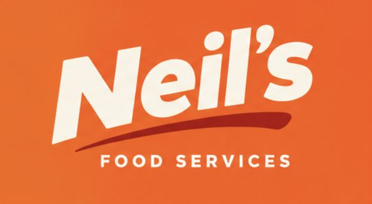

<p align="center">
  
</p>

# Neil's Food Services

Tienda de abarrotes con venta en línea y reparto: una app **Flutter** para Android y web, con la
tienda para los clientes y el panel para la tienda, contra un servidor **Serverpod** (Dart) con
PostgreSQL. Las cuentas las maneja Firebase.

| Parte | Carpeta | Qué hace |
|---|---|---|
| **App** (Flutter) | [`apps/client`](apps/client/README.md) | **Tienda:** catálogo con búsqueda y categorías, detalle, carrito (queda guardado), pedido y "Mis pedidos" con el seguimiento de cada uno. **Panel** (`/admin`, solo admin y staff): ventas del día, la semana y el mes, gráfico de 30 días, alertas de stock y vencimiento, top 5; pedidos con el avance de estado; productos; inventario; promociones. |
| **Servidor** (Serverpod) | [`apps/server`](apps/server/README.md) | Las rutas REST de todo lo anterior, con el ID token de Firebase y el rol en PostgreSQL. |
| Respaldo, en retiro | `apps/android`, `apps/api` | La app Kotlin y la API NestJS de antes. Se retiran cuando la app Flutter esté probada en un Android real. La web Next.js ya se retiró. |

Los pedidos siguen siempre los mismos estados: pendiente de confirmación → confirmado → en camino
→ entregado (o cancelado).

## Correr la demo

La guía paso a paso para Windows, con un guion para presentarla, cómo compartirla y qué necesita
otra computadora, está en [`docs/DEMO.md`](docs/DEMO.md). En corto, con Flutter en el `PATH`,
PostgreSQL y la base de desarrollo lista, dos terminales:

```powershell
cd apps\server\abarrotes_server; dart run bin/main.dart
```

```powershell
cd apps\client; flutter run -d web-server --release --web-hostname localhost --web-port 5006
```

Y abrir http://localhost:5006.

## Estructura

```
apps/client           App Flutter (Android y web): tienda y panel
apps/server           Servidor Serverpod (Dart) y su cliente generado
apps/android          App Kotlin (respaldo, en retiro)
apps/api              API NestJS (respaldo, en retiro)
packages/shared-types Contrato JSON de la API (Serverpod responde con la misma forma)
prisma                Modelo de datos de la API NestJS
docs                  Demo, arquitectura y hoja de ruta
```

## Documentación

- [Guía de la demo](docs/DEMO.md): levantarla, presentarla, compartirla y llevarla a otra
  computadora.
- [Arquitectura y hoja de ruta](docs/ARQUITECTURA_Y_ROADMAP.md): decisiones de diseño y fases.
- [App Flutter](apps/client/README.md): estructura, tema, rutas, el panel y los tests.
- [Servidor Serverpod](apps/server/README.md): requisitos, Firebase, datos de ejemplo y rutas.
- [CLAUDE.md](CLAUDE.md): convenciones del repositorio.

## Cómo se trabaja

- Ramas: `main` ← `develop` ← `feature/<nombre>`. A `main` y `develop` solo se llega por pull
  request; el hook `.githooks/pre-push`, que se activa con `npm install`, bloquea el push directo.
- Commits con Conventional Commits (`feat:`, `fix:`, `docs:`…), un cambio lógico por commit.
- Cada pull request corre el CI de GitHub Actions: la app Flutter (formato, análisis, tests y
  build web), Serverpod (tests con PostgreSQL, migraciones y arranque), y la API y la app Kotlin
  mientras sigan.
